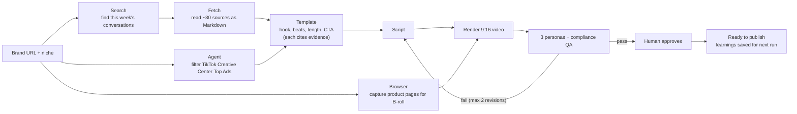

# TinyFish GTM Automation

You give it a brand URL and a niche. It finds what's trending in that niche this week, works out the short-video format that's currently winning, and turns that into a 9:16 video about your brand. Three simulated audience personas and a compliance reviewer then critique the video. If it fails, it rewrites and re-renders on its own. The finished video waits for a human to approve it, and what it learned feeds the next run.

Every piece of web work runs on live [TinyFish](https://tinyfish.ai) primitives (Search, Fetch, Agent, Browser), each doing the part of the job it's actually built for.

> **Status (Oct 11 2026, 12:51 PM PDT): work in progress.**
> - **Done:** the plan, the harness and the side services.
> - **Being built:** the `app/` pipeline and dashboard.
> - **What that means for this README:** anything marked *(planned)* describes what the code will do, not what it does yet.
> - **Real numbers:** cost per run, sources read and time taken get filled in from a real run before launch.

## Who it's for

- **Growth marketers and content leads** at startups who make short-form video. Today they research trends by hand: scrolling TikTok Creative Center, Reddit, Hacker News and competitors' feeds, then guessing at a format. This app does the research and drafts the first video. A human still approves before anything goes out.
- **Developers** at hackathons and accelerator demos who want to see TinyFish primitives combined into a real job, then fork it for their own brand or niche.

## What one run does



**Real target:** [tinyfish.ai](https://tinyfish.ai), niche "AI web agents / browser automation". `plan.md` proposes it and it isn't confirmed yet. It's a real brand with live conversations around it, so the video this produces is launch content TinyFish can actually use.

## Which primitive does which job, and why

Each primitive is there because it's the right tool for its step. None of them is in the pipeline just to hit a count.

| Primitive | Job in this workflow | Why this one and not another |
|---|---|---|
| **[Search](https://docs.tinyfish.ai/search-api)** | Finds this week's conversations and competitor content in the niche. Uses `recency_minutes`, `domain_type=news`, and `include_domains` for Reddit, HN and YouTube. | It's the only primitive that discovers URLs we don't already have. It returns ranked results with snippets in 1–3s and is free. |
| **[Fetch](https://docs.tinyfish.ai/fetch-api)** | Reads the ~30 URLs that Search found and returns clean Markdown for the analyst step. | These are known URLs that need no clicking. Fetch takes up to 10 URLs per call, renders JS-heavy pages, reports per-URL failures without failing the batch, and is free. It's the cheapest way to read a lot of pages. |
| **[Agent](https://docs.tinyfish.ai/agent-api)** | Opens TikTok Creative Center → Top Ads, sets the region, industry and period filters, opens individual ads, and returns JSON with each ad's hook, format, CTA and length. | Fetch only gets an empty page shell there (we tested it). The data appears only after filters are clicked, so it needs a goal-driven agent rather than a reader. |
| **[Browser](https://docs.tinyfish.ai/browser-api)** | A scripted Playwright session over CDP takes screenshots and scrolling clips of the brand's product pages at exact 1080×1920 framing. These become the video's B-roll and the evidence wall. | We need pixels framed the same way on every run. Agent runs do save step screenshots, but those show whatever the agent happened to look at, and Agent bills $0.016 per step. Browser gives our own code full control for $0.002 per minute. |
| **[Vault](https://docs.tinyfish.ai/key-concepts/credentials)** *(stretch)* | After approval, logs into the brand's own scheduling tool and saves the video as a **draft**. | It's the only way to give an agent a login without the password touching our code or the LLM. The agent sees field labels only; TinyFish types the values. |

**Cheapest tool first.** The pipeline climbs Search → Fetch → Agent → Browser and only moves up a step when the cheaper one can't do the job. If Agent gets blocked (a CAPTCHA, or `COMPLETED` with a failure in `result`), the orchestrator logs it and falls back to Search with `include_domains` plus Fetch, and the run keeps going. That's the "self-healing" part. Per the [FAQ](https://docs.tinyfish.ai/faq), `COMPLETED` only means the browser didn't crash, so the pipeline always checks `result` as well.

## What it costs

Pricing below is taken from [tinyfish.ai/pricing](https://www.tinyfish.ai/pricing) on Oct 11 2026.

| Primitive | Price | Account limit |
|---|---|---|
| Search | free | 30 req/min, 500 req/hour* |
| Fetch | free | 150 URLs/min, 1,000 URLs/day |
| Agent | $0.016 / step | 2 concurrent runs |
| Browser | $0.002 / minute | 5 concurrent sessions |

New accounts start with $8 in the wallet, so Agent and Browser work before you add a card. The pipeline enforces a **$1 cap per run** *(planned)*. LLM calls for strategy and QA cost extra and are metered separately *(planned)*.

*The [Search docs](https://docs.tinyfish.ai/search-api) say "free up to 12,000 requests per day", which doesn't match the pricing page's hourly limit. We'll raise this with the TinyFish product team.

## Run it *(planned)*

```bash
# 1. Get a key at https://agent.tinyfish.ai/api-keys
cp app/.env.example app/.env   # TINYFISH_API_KEY, ANTHROPIC_API_KEY; ELEVENLABS_API_KEY optional

# 2. Install and run
cd app
uv sync
uv run gtm run --brand https://tinyfish.ai --niche "AI web agents"

# 3. Watch it: trend charts, evidence wall, v1 → v2 video with QA scorecards, budget meters, Approve button
uv run streamlit run dashboard.py
```

Each run writes everything to `app/runs/<run_id>/`: `evidence.json`, charts, screenshots, each script and video version, QA results, and an `activity.jsonl` log. The dashboard can replay any past run.

## Repo layout

| Path | What's there |
|---|---|
| `app/` | The pipeline and the Streamlit dashboard (Python, uv). Becomes `app.zip` in the deliverable. *(being built)* |
| `harness/` | [Paperclip](https://github.com/paperclipai/paperclip) in Docker on port 3100. It provides the agent org chart, tickets, budgets and approvals. Run `cd harness && ./up.sh`. |
| `photon/` | iMessage interface built on [Photon](https://photon.codes) (`spectrum-ts`). Lets you start a run, check status and approve by text. Run `cd photon && npm start`. |
| `agentmail/` | Creates [AgentMail](https://agentmail.to) inboxes so the agents have their own email addresses. |
| `brightdata/` | Gateway to [Bright Data](https://docs.brightdata.com)'s pre-built scrapers. Gets TikTok, Instagram Reels, YouTube and Reddit posts with views, engagement, length and sound, plus the top comments under them. Used for trend analysis and to ground the QA personas. It runs alongside TinyFish: Search finds the URLs, and Bright Data returns the engagement numbers that Fetch doesn't. |
| `docs/` | `gtm.md` (product requirements and long-term vision), `deliverable.md` (the brief), and two diagrams: `flow.png` (the vision) and `demo-flow.png` (an early demo sketch). Where these differ from this README, `plan.md` and this README win. |
| `plan.md` | Scope, architecture, timeline and risks. |
| `CURRENT.md` | Shared work log for the parallel build sessions, newest entry first. |

`paperclip/` is a local clone of upstream that we keep for reference only. It's gitignored. Clone it yourself if you want the source.

## Guardrails

- **Nothing posts automatically.** The pipeline stops at "ready to publish" and waits for a human. The Vault stretch goal only ever saves a **draft**.
- **Persona scores are labeled *simulated*.** They're an AI critique, not real audience validation.
- **Every claim in a script must cite** either a fetched source or a page on the brand's own site. The compliance reviewer rejects any claim that doesn't.
- **Credentials never touch the code or the LLM.** Logins go through Vault. API keys live in `.env`, which is gitignored.
- **The pipeline respects each platform's access limits.** Where a site blocks access (Meta Ad Library returns 403, LinkedIn returns 999), it doesn't try to get around it. It uses a different source instead.

## Out of scope today

- **[Monitor](https://docs.tinyfish.ai/monitor):** a daily topic feed, so research runs on a schedule instead of on demand.
- **Vault + [Browser Context Profiles](https://docs.tinyfish.ai/key-concepts/browser-context-profiles):** stay logged in to the brand's scheduler across runs.
- **Real engagement data:** pull in real numbers after publishing, so learnings come from actual audience results and not only QA.
- **Growth Analyst agent:** compares campaigns and proposes experiments.

## References

- TinyFish docs: <https://docs.tinyfish.ai> ([single-page context for coding agents](https://docs.tinyfish.ai/for-coding-agents))
- TinyFish cookbook: <https://github.com/tinyfish-io/tinyfish-cookbook>
- Paperclip: <https://github.com/paperclipai/paperclip>
- Photon: <https://photon.codes>
