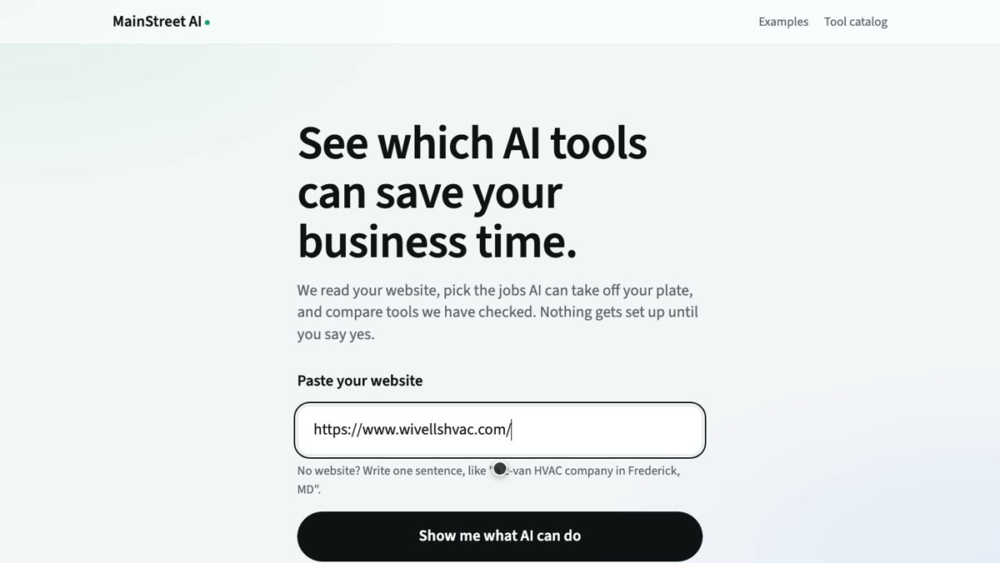
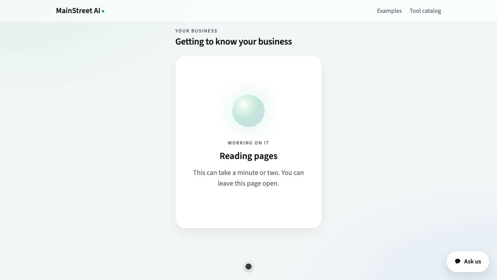
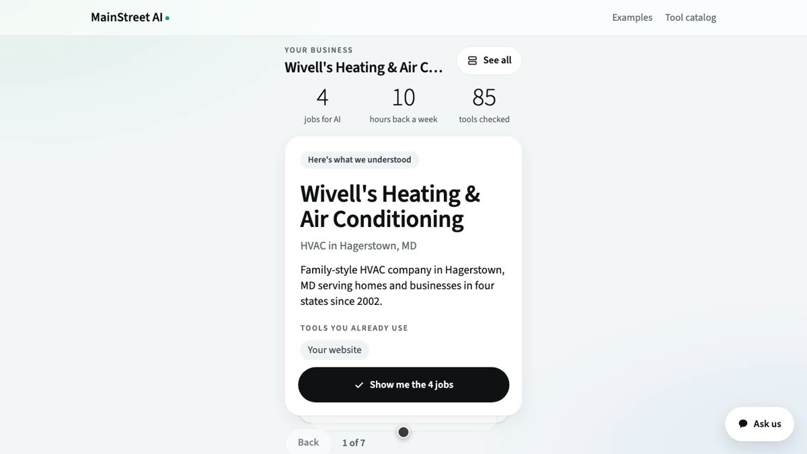
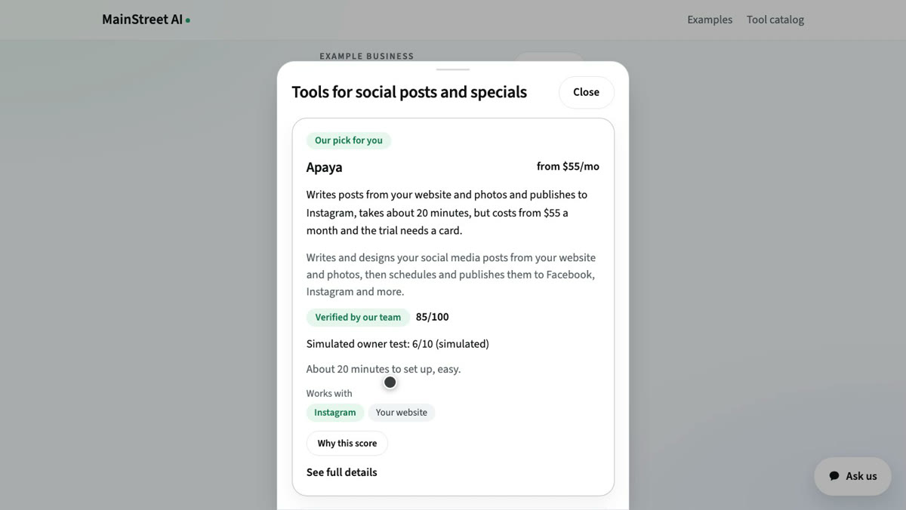
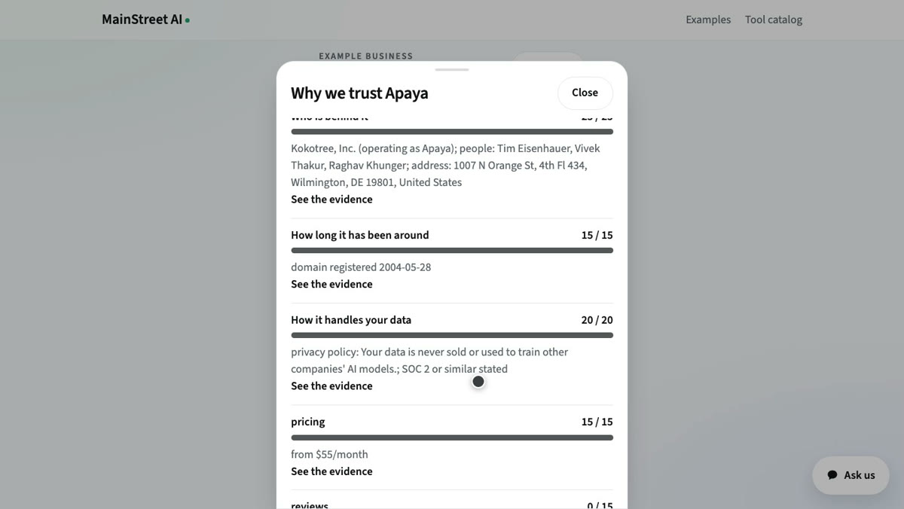
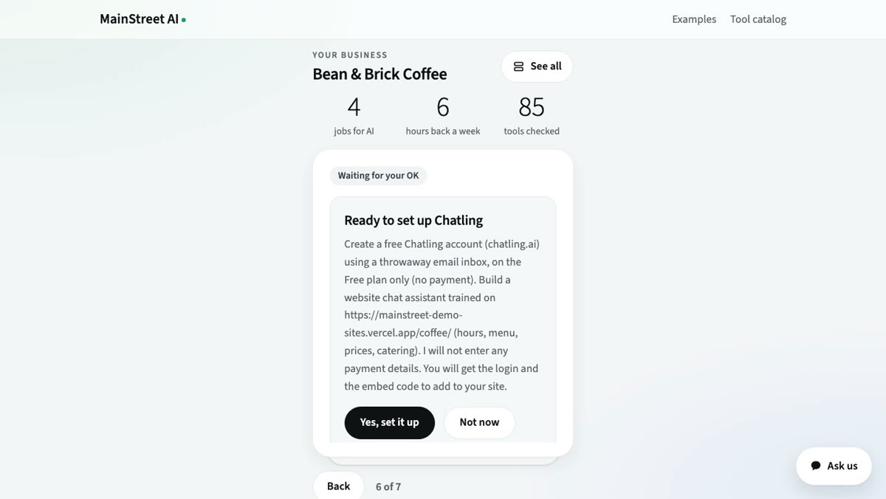
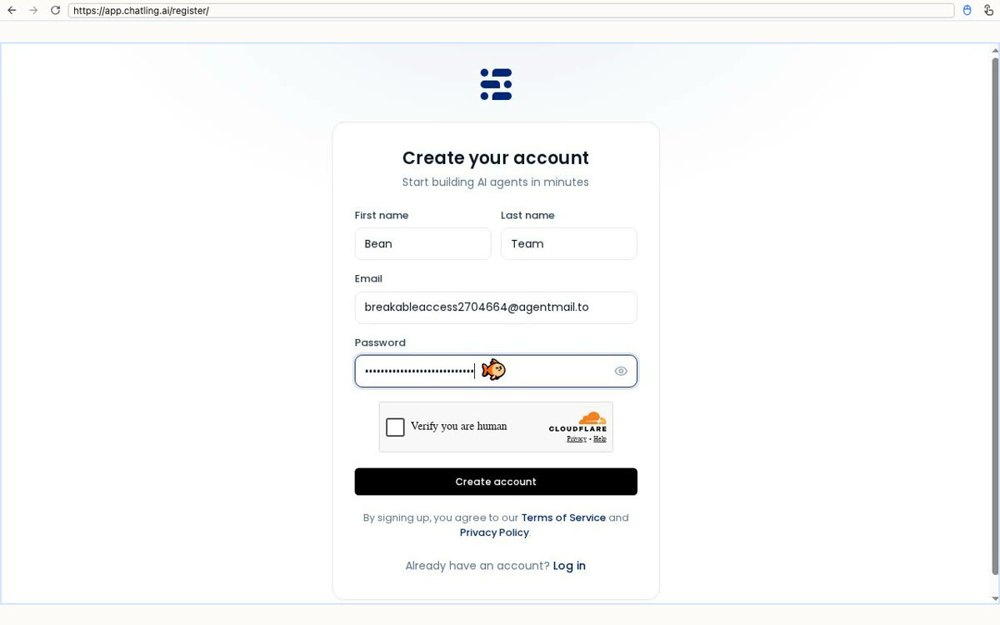
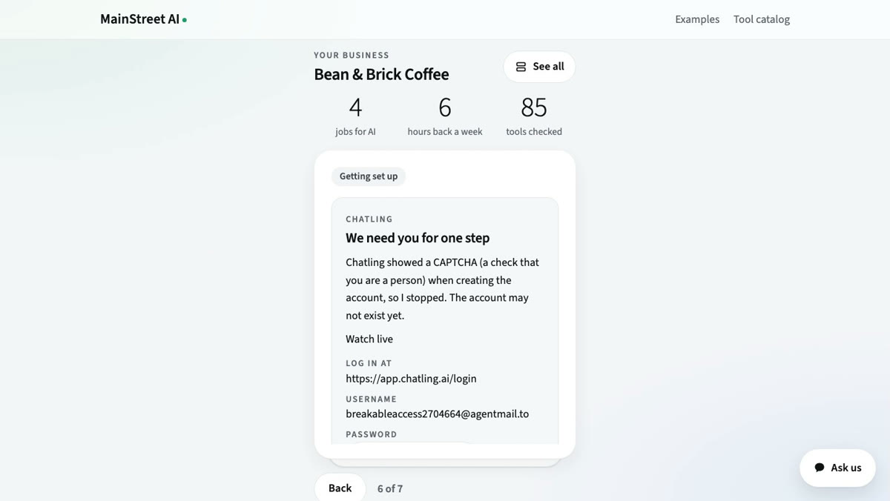
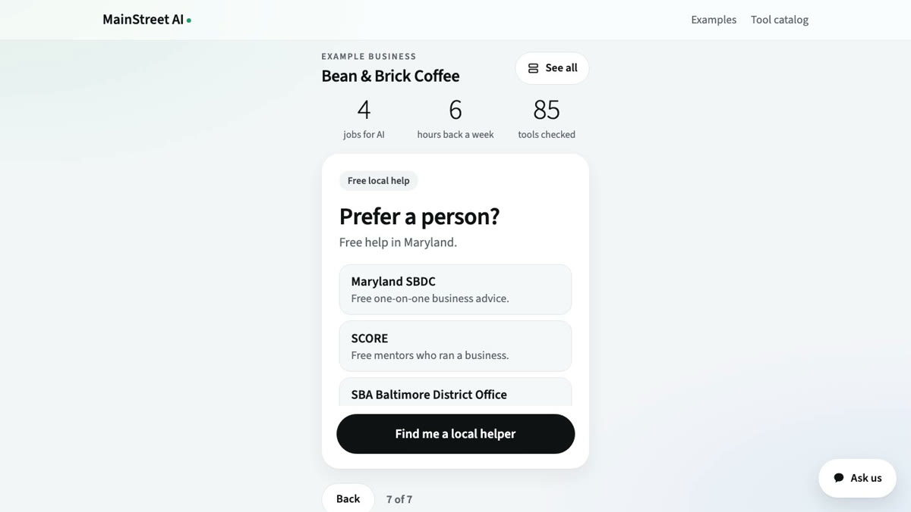

# MainStreet AI: prototype link and quick tutorial

Team Forge: Ishaan Kalra and Dylan. AI for Small Business Hack-a-thon, Fall 2026.

**Prototype:** [https://mainstreet-ai-five.vercel.app](https://mainstreet-ai-five.vercel.app)

**Video:** MainStreet AI - Team Forge.mp4 (in this folder)

MainStreet AI is an Angie's List for AI tools. An owner pastes their website, an agent reads the business and picks the jobs AI could take off their plate, compares tools from a catalog a person has checked, and with the owner's yes, sets one up.

## How to try it

**1. Paste a business website and press "Show me what AI can do".** No website? Describe the business in one sentence. To skip this step, open Examples at the top of the page.

**2. The agent reads the site in its own sandbox.** It takes about a minute; you can leave the page open.

**3. See what it understood and the jobs AI could take on,** ranked by hours saved each week.

**4. Open a job to compare up to three checked tools:** price, free plan, setup time, and which of your current tools they work with.

**5. Press "Why this score".** Every tool has a trust score out of 100 from six checks, and every point links to its evidence.

**6. Nothing is set up without your yes.** The agent writes down exactly what it will do and waits for "Yes, set it up".

**7. On yes, it signs up in a cloud browser with a fresh email inbox, on the free plan.** At a CAPTCHA, phone check or payment page it stops and hands that step to you. It never enters card details.

The set-up shown here runs on Bean & Brick Coffee, a made-up coffee shop with a test website, because we never sign up for a real business without its owner.

**8. Prefer a person?** Every page links free local help: the Maryland SBDC, SCORE and the SBA Baltimore District Office.

## iMessage

The same agent also works over iMessage: text it like a friend, get a few short replies, and the link opens the same business on the web. Our iMessage provider's free plan only answers phone numbers we approve, so iMessage is shown in the video as a live demo and is not part of the shareable link. Opening it to everyone needs a paid plan (about $100). The web app link above works for anyone.
